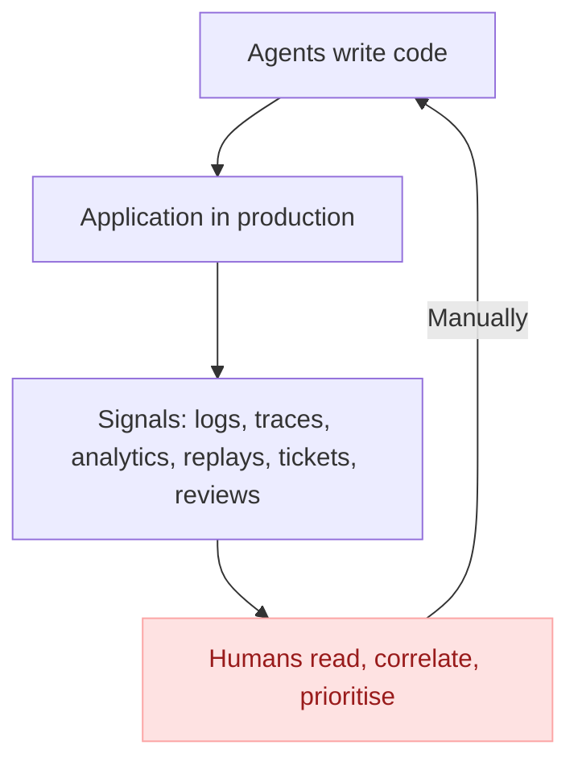
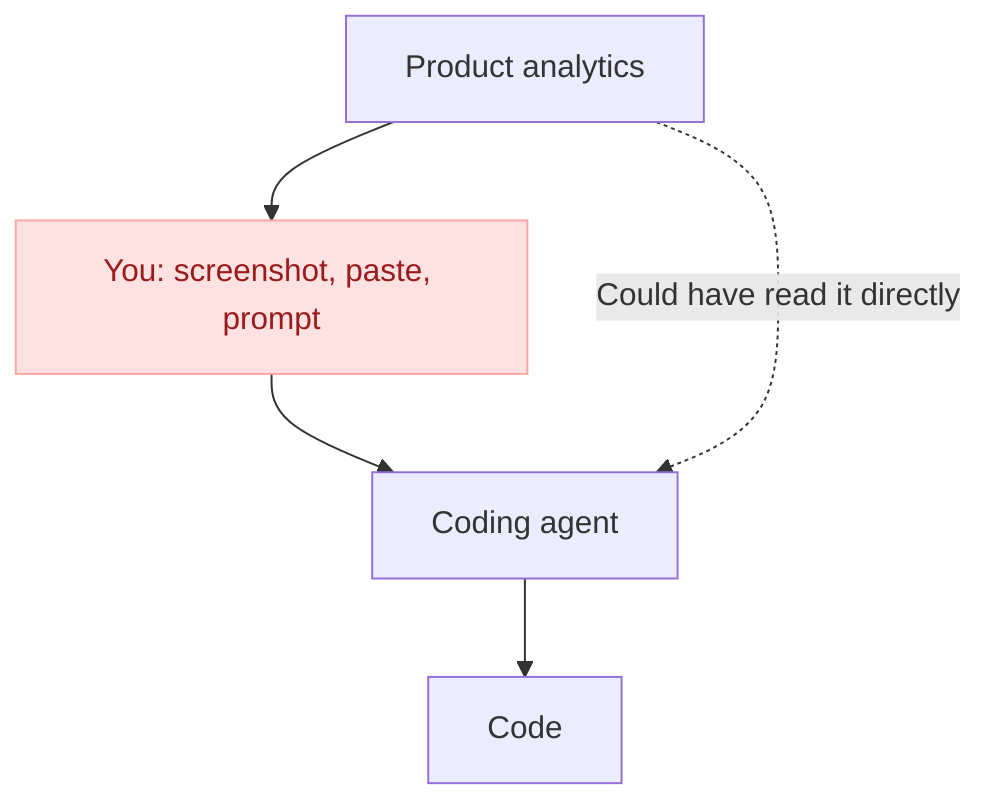
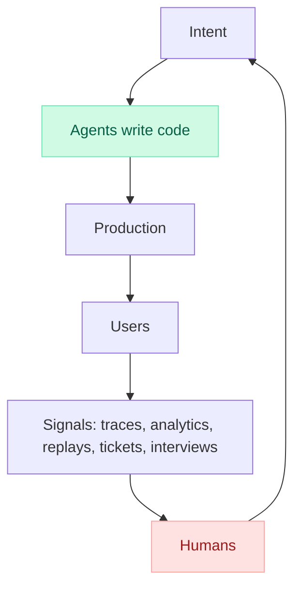
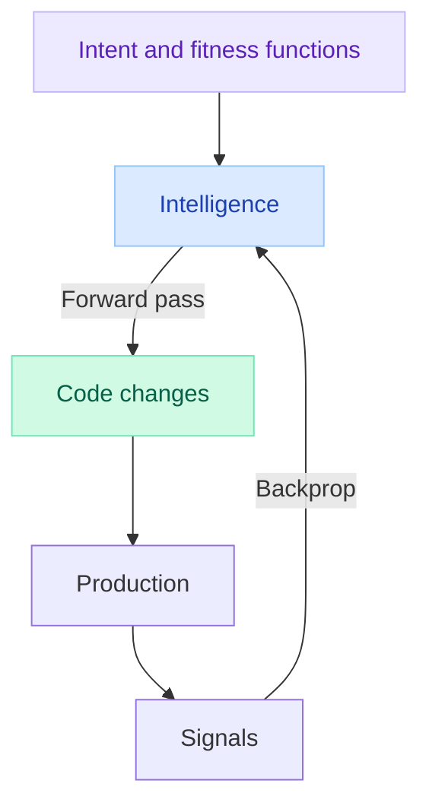
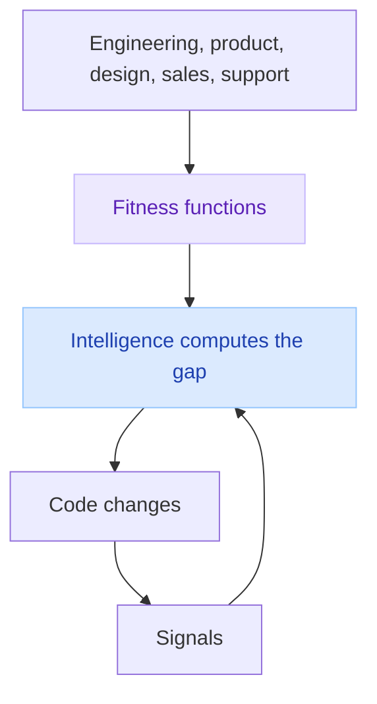

The release you shipped this morning already surfaced what's wrong with it. It's been telling you all day, across multiple surfaces. The only reason prod is still failing is you.

Agents write the vast majority of software now, they can one-shot an application, deploy it, and wire up its observability before your coffee gets cold. But it's a one way street. Agents produce more software, that software produces more signal, and almost none of that signal ever makes its way back to the agents. We are the ones bringing this data back into agents manually.

We have built tooling to help us query, visualise, organise, triage and prioritise this signal. I was part of this, I spent the best part of the past decade building observability tooling. But ultimately, it still takes someone to read the data and decide what needs to be improved.

**Self-improving software is inevitable**. Applications that read their own signals, decide what to change, ship the change, and check whether it worked. And once software can improve itself, it can improve the machinery that improves it: better observability, sharper detection, deeper investigations, better fixes, each loop tightening the next one.

For that to happen, we have to give up being in charge. Engineers, PMs, designers, all of us. We have to stop being the meat proxies who decide what gets fixed next, and when.

## Right now, people are the feedback loop

Every source of signal has its own tool, engineers and SREs use Datadog, product managers are in Amplitude, designers in FullStory, support in Zendesk, etc.

When users face issues in prod, the errors get recorded in the observability tooling, the rage clicks saved in the session replays, there's a dip in product metrics, and an increase in support tickets.

A PM needs to notice all these, investigate and correlate the various signals, compress this information into a ticket, and prioritise it for next week. Then it lands on the desk of an engineer who prompts an agent to turn it into code.

This makes no sense in 2026 when agents are intelligent enough to solve some of the hardest maths problems humanity ever faced. It takes very little intelligence to parse errors and prioritise them.

## Are we all meat proxies?

When you take a screenshot of your product analytics dashboard, paste it into Claude Code and prompt "investigate why this chart is going down and fix it", you're a meat proxy.

A meat proxy is a person whose only job is to carry information between two machines that could perfectly well talk to each other. The dashboard has the data, and the agent has the intelligence. You sit in the middle, deciding what to look at, when to look at it, and how to describe it, that's a meat proxy.

MCPs and connectors make the proxy faster, but you're still the proxy.

## Automations have an unknown unknowns problem

There's a lot of agent tooling with automations, I even built one myself: they are essentially cron-jobs and webhooks that trigger an agent with a given prompt:

> listen to Honeycomb alerts and investigate every time one fires

> every time sentry opens a new issue, investigate it and open a PR with a fix

> every morning, check our product metrics, if activation falls below 10% investigate and write a fix

This feels incredibly productive. Every alert gets a write-up before anyone opens their laptop, every new exception gets a pull request.

But these automations only ever see what someone already decided was worth seeing. They inherit every blind spot of the system that triggers them.

Someone had to decide what to alert on, what SLOs to define, and these inherently are incomplete. It's impossible to alert on the emergent behaviour of a complex application.

That's the unknown unknowns problem. Known problems get detected, because someone already wrote the alert or the exception handler. Unknown problems never get detected, because nothing exists to detect them. The agent becomes incredibly fast at fixing the problems you already knew how to find, and the problems costing you the most customers are, almost by definition, the ones you didn't.

## Applications need backpropagation

Think of a piece of software as a neural network. 

The code is the weights and biases, and every change to the code is an update to those weights. Users interact with it, and the signals they produce (traces, clicks, tickets, churn, revenue, etc.) are the output.

With this analogy, the two stages of self-improving software are:

- The **forward pass**: intent goes in, code comes out. Coding agents have "solved" this phase of the training iteration. We can one-shot fairly complex applications with a single prompt, and even deploy them and connect all the necessary observability and product tooling.

- The **backpropagation**: compare the output to what you wanted, compute the gap, and push it back through the system to adjust the weights. For an application, that's taking all the signal it produces in prod, figuring out what it says about the code, and changing the code accordingly.

We've automated the forward pass and kept the backprop manual. Every week we push dozens of weight updates into production, and compute the gradient at a planning session, at best weekly, at some companies quarterly, by hand. This planning is based on the memory of the PMs, a sample of twenty session recordings and whichever three customer complaints were loudest.

If we were training models like this, we wouldn't have anything worth anyone's time.

## Intelligence is now too cheap to meter

In this analogy, backpropagation is manual for one reason: nothing else can read an error log, find the corresponding set of traces, cross-reference them with session replays, understand why a customer was angry, and decide what to change. That took judgement, and good judgement was scarce and expensive.

That's no longer the case. We now have intelligence too cheap to meter. It can read every trace, watch every session, read every ticket and every interview transcript, and join them together in minutes.

We can put intelligence both in the forward pass and in the backprop, increase iteration speed, and achieve self-improving software.

## What's our role then?

A neural net without a loss function is just a very expensive random number generator. Backprop needs to know what "better" means.

In this analogy, our job becomes defining what "better" means. Engineers, product managers, designers, sales, support: everyone's role becomes defining the fitness functions the system optimises against.

| Who | What they optimise | Fitness functions |
|---|---|---|
| Engineers | The health of the system | p99 latency, error rates, availability, cost per request, cold start times |
| Product | The behaviour of users | Conversion, activation, retention, time to value, feature adoption |
| Designers | The user experience | Task completion, time on task, rage clicks, drop-offs, abandoned forms |
| Sales | Revenue | Growth, win rates, expansion, deal velocity, churn |
| Support | How much the product hurts | Ticket volume, time to resolution, CSAT, duplicate tickets |

The challenge is that these functions often pull against each other. A faster checkout can hurt fraud detection, a simpler onboarding can lower activation for power users, a discount can grow revenue and kill margins, etc.

Deciding how to weigh them, which ones are hard constraints, and which customers you're optimising for is the hard part. Ultimately, it's deciding what the company is trying to achieve, and writing it down precisely enough that a machine can optimise for it. And honestly, it was always the hard part.

## An era of abundance ahead

Give a cloud coding agent read access to all your signal sources at once (observability, product analytics, session replays, support tickets) and write access to your repo. Then put these on a schedule.

> every hour, read every new error, trace, session replay and support ticket from the last hour. group anything that looks like the same problem, even if it shows up in different tools. for each group, find the release that introduced it and open a PR with the fix and all the evidence attached

> every morning, compare yesterday against these goals: checkout p99 under 300ms, error rate under 0.1%, activation above 25%, fewer than 20 support tickets a day. for anything moving in the wrong direction, find the cause in the code and open a PR. if everything is on track, find the change most likely to move these numbers next and open a PR for it

We're so close. Self-improving software is inevitable, and for the first time, it's close enough to build.
